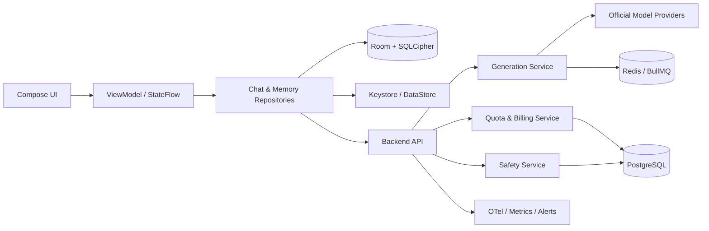

# AI 人机陪伴产品技术方案 v1

日期：2026-11-17

目标平台：Android

产品边界：成年人、非露骨、长期记忆型 AI 伴侣

## 1. 最终建议

采用 **Kotlin + Jetpack Compose 的 Android 原生客户端**，通过自有后端调用正式模型供应商 API。

Chatbox 只作为以下内容的参考：

- OpenAI-compatible Provider 协议。
- SSE 流式响应。
- 会话和消息的数据组织。
- 上下文压缩与摘要。
- 聊天记录导入导出。

不直接复用 Chatbox 的 React UI、Electron 层和桌面设置体系，也不在 WebView 中运行整个 Chatbox。

Android 首版不引入 Kotlin Multiplatform。`core:model` 保持纯 Kotlin，为未来共享业务模型留出空间。

## 2. 架构决策与 Agent 分歧收敛

| 编号 | 决策 | 结论 |
| --- | --- | --- |
| ADR-01 | Android UI | Kotlin + Jetpack Compose |
| ADR-02 | 客户端形态 | 原生 APK，不使用整套 Chatbox WebView |
| ADR-03 | 后端形态 | NestJS 模块化单体，不做微服务 |
| ADR-04 | 聊天记录 | 默认只在手机加密数据库保存 |
| ADR-05 | 模型密钥 | 只保存在后端密钥管理系统 |
| ADR-06 | 模型供应 | 官方 API 或明确授权的云厂商，不依赖不明中转站 |
| ADR-07 | 记忆检索 | MVP 使用结构化记忆 + 全文检索，抽象检索接口 |
| ADR-08 | 多端策略 | Android-only 阶段不引入 KMP；iOS 立项后再共享纯 Kotlin 模型 |

### 2.1 交叉评审结论

Android Agent 最初建议构建 12～15 个模块。最终建议先建 12 个左右，先保证边界清晰，不为了“模块化”过早拆成几十个小工程。

记忆 Agent 支持 MVP 使用结构化记忆和全文检索，但指出中文 FTS 召回较弱。因此首版虽然不引入向量数据库，但必须通过 `MemoryRetriever` 接口隔离检索实现，后续可以增加本地 embedding 或服务端语义检索。

后端 Agent 支持服务端做最终安全裁决，但不同意“所有聊天正文绝不持久化”的绝对表述。普通对话默认不保存正文；低风险事件保存哈希和分类；高风险、投诉或人工复核保存最小必要片段，并进行加密、短保留期和独立权限控制。

## 3. 总体架构



核心原则：

- UI 不直接访问网络或数据库。
- 聊天原文默认只在设备保存。
- 服务端按请求组装发送给模型，但普通请求不落正文。
- 订阅和额度以服务端账本为准。
- 内容安全裁决由服务端负责，客户端只做即时交互和安全提示。

## 4. Android 客户端

### 4.1 技术栈

| 领域 | 选型 |
| --- | --- |
| 语言 | Kotlin |
| UI | Jetpack Compose、Material 3 |
| 导航 | Navigation Compose |
| 状态 | ViewModel、StateFlow、Flow |
| 网络 | OkHttp、Retrofit、Kotlin Serialization |
| 流式协议 | OkHttp SSE / EventSource |
| 数据库 | Room |
| 数据库加密 | SQLCipher + Android Keystore |
| 配置 | DataStore |
| 后台任务 | WorkManager |
| 依赖注入 | Hilt |
| 图片 | Coil |
| 日志 | Timber + 脱敏日志端口 |
| 测试 | JUnit、Turbine、MockWebServer、Compose UI Test |

### 4.2 模块划分

```text
:app
:core:model
:core:common
:core:designsystem
:core:network
:core:database
:core:security
:data:account
:data:billing
:data:chat
:data:memory
:feature:onboarding
:feature:chat
:feature:companion
:feature:memory
:feature:subscription
:feature:settings
```

首批可以从 12 个实际模块开始，将其中的账号、订阅或伴侣功能暂时放入相邻模块；出现独立发布、独立测试或团队并行需求时再拆。

约束：

- `core:model` 不依赖 Android SDK。
- `feature:*` 不直接依赖 Room Entity 或 HTTP DTO。
- `data:*` 对 Feature 暴露 Repository 和领域模型。
- 所有模型 API Key、计费密钥和后台管理密钥不进入 APK。

### 4.3 聊天生成状态机

```text
IDLE
  -> SUBMITTING
  -> STREAMING
  -> COMPLETED

SUBMITTING/STREAMING
  -> CANCELLED
  -> INTERRUPTED
  -> FAILED

INTERRUPTED/FAILED
  -> RETRYING
```

具体流程：

1. Compose 提交消息。
2. 客户端生成 `client_message_id` 和 `generation_id`。
3. 用户消息立即写入 Room，状态为 `PENDING`。
4. 客户端组装受限上下文并发起后端请求。
5. 服务端流式返回增量文本。
6. 客户端在内存中累积内容，每 300～500ms 或达到固定长度后写一次草稿。
7. 完成后在单个事务中写入最终消息、usage、状态和记忆抽取任务。
8. 取消时同时取消 OkHttp Call 并调用后端取消接口。
9. 进程被杀后根据 `generation_id` 恢复草稿或标记为 `INTERRUPTED`。

禁止：

- 每个 token 都写数据库。
- 断网后自动重复扣费。
- 使用时间戳作为唯一消息顺序。
- 在客户端修改本地会员状态来解锁权益。

### 4.4 消息和本地数据库

核心表：

```text
conversations
  id, companion_id, title, created_at, updated_at, deleted_at

messages
  id, conversation_id, role, sequence, content,
  status, parent_message_id, created_at, updated_at

message_parts
  id, message_id, type, content_or_uri, metadata_json

companions
  id, name, persona_json, speaking_style, boundaries,
  avatar_ref, profile_version, created_at

memory_items
  id, companion_id, type, fact_key, value, confidence,
  importance, source_message_ids, user_confirmed,
  valid_from, valid_to, superseded_by, deleted_at

memory_summaries
  id, conversation_id, start_sequence, end_sequence,
  summary, token_count, model, prompt_version, fidelity_status

generation_runs
  id, conversation_id, client_message_id, assistant_message_id,
  request_id, model, status, input_tokens, output_tokens,
  error_code, created_at, completed_at

safety_states
  id, conversation_id, local_risk_level, server_risk_level,
  intervention_type, created_at, acknowledged_at
```

`messages.sequence` 在同一会话内唯一且单调递增。所有客户端生成的 ID 使用 UUID 或 ULID。

### 4.5 本地安全

- SQLCipher 数据库使用随机生成的 32 字节数据库密钥。
- 数据库密钥通过 Android Keystore 的 AES-GCM 包装。
- 禁止把数据库密钥写入 DataStore、SharedPreferences 或普通文件。
- `android:allowBackup="false"`。
- 崩溃日志和运营日志禁止记录聊天正文。
- 用户可设置锁屏通知是否隐藏内容。
- 导出文件使用用户密码派生密钥加密，并明确密码丢失不可恢复。
- 设计 Keystore 密钥失效后的重新登录和重新加密流程。

## 5. 记忆与上下文工程

### 5.1 四层记忆

1. 最近对话原文。
2. 覆盖旧区间的滚动摘要。
3. 结构化事实和偏好。
4. 关系事件、约定和用户边界。

用户明确输入或修改的记忆优先级最高。模型推断的记忆必须带来源消息、置信度和生成版本。

### 5.2 记忆类型

- `fact`：用户姓名、职业、家庭关系等可验证事实。
- `preference`：喜欢的表达方式、话题、称呼等。
- `event`：发生过的重要事件和共同经历。
- `boundary`：用户不希望讨论或扮演的内容。
- `promise`：AI 在对话中明确答应过、且用户可以接受保留的约定。

关系事件只记录“发生了什么”，不能覆盖用户身份事实。

### 5.3 抽取时机

- 用户消息完成后的轻量规则抽取。
- 每 6～10 个完整对话轮次进行一次结构化记忆抽取。
- 用户显式点击“记住这件事”时立即抽取。
- 长对话在达到上下文预算前生成摘要。
- 摘要和抽取失败不阻塞聊天，使用 `pending` 状态等待后台重试。

### 5.4 冲突和修正

- 新的用户显式事实通过 `superseded_by` 替代旧事实，不直接覆盖历史。
- 用户点击“删除”时写 tombstone，重建摘要时避开该消息。
- 新事实与旧事实无法判断时，角色不自行编造，改用中性询问。
- 低置信度记忆不进入普通请求。
- 重要关系事件不直接合并，以时间线保留。

### 5.5 上下文拼装顺序

1. 服务端系统安全规则和 AI 身份声明。
2. 角色卡、表达风格、关系边界。
3. 用户确认的高优先级事实和边界。
4. 与当前话题相关的结构化记忆和关系事件。
5. 旧对话摘要。
6. 最近若干轮原文。
7. 当前用户消息。

预算建议只在模型窗口确定后动态计算：

- 为输出预留 20%～25%。
- 系统安全与身份 5%。
- 角色卡 10%。
- 显式记忆和边界 15%。
- 摘要 20%。
- 最近原文 15%。
- 检索记忆 10%。

超预算顺序：

1. 压缩旧摘要。
2. 减少低优先级关系事件。
3. 丢弃低置信度推断记忆。
4. 缩短最近原文窗口。

无论如何不能截断当前用户消息。

### 5.6 摘要规则

- 摘要按完整对话轮次分段。
- 每段记录 `start_sequence`、`end_sequence`、模型和 prompt 版本。
- 摘要不覆盖原文。
- 摘要必须忠实，不允许加入原文没有的事实。
- 摘要生成失败时回退到“最近原文 + 明确的旧摘要 + 高优先级事实”。
- 模型切换不改变角色卡和事实记忆，只切换生成模型。

### 5.7 检索策略

MVP：

- 按角色、记忆类型、重要度和更新时间过滤结构化记忆。
- 使用 FTS4、FTS5 或自建中文 n-gram 索引做文本召回。
- 对来源消息做时间衰减，但用户确认的边界不过期。

引入向量检索的条件：

- 结构化召回已经无法覆盖常见问题。
- 记忆规模达到数千条，过滤和全文召回不足。
- 离线评测中“语义相关但字面不重合”的失败比例明显。
- 本地 embedding 的设备性能、耗电和数据库迁移成本经过验证。

通过 `MemoryRetriever` 接口隔离检索，不让上层依赖 FTS 或向量实现。

## 6. 服务端

### 6.1 技术栈

MVP：

- NestJS + Fastify + TypeScript。
- PostgreSQL。
- Redis + BullMQ。
- S3 兼容对象存储，仅用于必要的非聊天文件。
- OpenAPI + 自动生成客户端契约。
- OpenTelemetry、指标和告警。

小团队使用 TypeScript 有利于模型 SDK、SSE、OpenAPI 和快速迭代。只有流式生成并发出现明确瓶颈后，才把 Generation Service 拆成 Go 服务。

### 6.2 模块化单体

```text
auth
account
generation
provider-adapter
memory-assist
safety
billing
quota
admin
observability
```

首版不拆微服务，但按模块隔离数据库表和权限。

### 6.3 模型 Provider

客户端只访问自有后端：

```text
Android -> Backend /v1/generations -> Official Provider
```

Provider Adapter 统一：

- 模型标识和版本。
- 请求格式。
- SSE 增量解析。
- usage 统计。
- 超时、取消和错误映射。
- 安全过滤和日志脱敏。

API Key 放云端 Secret Manager，按环境隔离并支持轮换。

不直接依赖不明中转站。若使用云厂商或聚合平台，必须确认允许客户-facing 应用、数据保留策略、地区限制和转售限制。

## 7. API 与流式协议

### 7.1 创建生成

```http
POST /v1/generations
Authorization: Bearer <access_token>
Idempotency-Key: <uuid>
Content-Type: application/json
Accept: text/event-stream
```

请求示例：

```json
{
  "conversation_id": "uuid",
  "client_message_id": "uuid",
  "assistant_message_id": "uuid",
  "companion_id": "uuid",
  "companion_version": 3,
  "model_mode": "standard",
  "context": [
    {"role": "system", "content": "角色与安全上下文"},
    {"role": "user", "content": "当前用户消息"}
  ]
}
```

服务端应追加自己的安全系统提示，不能完全信任客户端提供的 system prompt。

SSE 事件：

```text
generation.started
message.delta
safety.signal
usage.updated
generation.completed
generation.failed
heartbeat
```

示例：

```text
event: message.delta
data: {"generation_id":"g_123","text":"我在听。"}

event: safety.signal
data: {"level":"crisis","action":"show_support_resources"}

event: generation.completed
data: {"usage":{"input_tokens":1842,"output_tokens":286}}
```

另设：

```text
POST /v1/generations/{generation_id}/cancel
GET  /v1/me/entitlements
POST /v1/purchases/verify
POST /v1/privacy/delete-requests
POST /v1/reports
```

### 7.2 幂等

- 数据库对 `(user_id, Idempotency-Key)` 建立唯一约束。
- `client_message_id` 也必须有唯一约束。
- 同一请求重试不能创建第二次扣费。
- 断线不自动重新生成。
- 用户明确重试时产生新的 `generation_run`，并记录 `retry_of`。

## 8. 额度与订阅

### 8.1 账本模型

不使用可直接修改的单一余额字段。

核心表：

```text
plans
subscriptions
purchases
usage_reservations
usage_settlements
ledger_entries
generation_runs
```

流程：

1. 生成前按模型档位和最大输出预留额度。
2. 上游返回 usage 后结算实际用量。
3. 未使用部分释放。
4. 失败按策略释放或只扣除已经产生的 token。
5. 取消后结算已生成部分。
6. 每次赠送、扣费、退款都写不可变账本流水。

### 8.2 订阅状态

```text
pending
  -> active
  -> past_due
  -> canceled
  -> expired
  -> refunded
```

客户端只展示服务端返回的权益。Google Play 或其他商店的购买 token 由后端校验，并向客户端下发权益结果。

## 9. 安全和合规工程

### 9.1 年龄和未成年人保护

- 产品明确仅面向成年人。
- 使用合规实名或年龄核验服务。
- 服务端只保存“成年已验证”结果和年龄段，不保存身份证图片。
- 未成年人识别后直接阻断虚拟伴侣服务。
- 年龄验证必须服务端强制，不只是客户端弹窗。
- 用户提出申诉时提供人工复核入口。

### 9.2 AI 身份和依赖

- 首次使用和重新登录时显著提示 AI 身份。
- 聊天界面持续显示非真人标识。
- 不允许角色声称自己是真人。
- 连续使用每超过 2 小时提醒注意时长。
- 使用时长、异常频率和替代现实社交的表达作为依赖风险信号。
- 依赖风险提醒使用支持性、非羞辱语言。
- 不做“亲密度越高越需要付费”的机制。

### 9.3 危机干预

安全状态：

```text
normal
reminder
dependency_risk
crisis
```

处理流程：

1. 本地规则做高风险快速提示。
2. 服务端模型分类器做二次判断。
3. `crisis` 状态暂停普通伴侣人格化回复。
4. 展示安全引导、当地紧急求助资源和专业帮助。
5. 根据用户事先同意的机制联系紧急联系人。
6. 高风险事件只保留最小必要证据，独立加密、独立权限和短 TTL。
7. 不允许模型通过过度迎合继续加深危机。

### 9.4 数据分级

- 普通对话：只保留请求 ID、token、延迟、状态，不保存正文。
- 低风险命中：保存正文哈希、风险分类、处置结果。
- 高风险或人工复核：保存最小必要文本片段，加密、短保留期、可审计访问。
- 用户投诉：按投诉处理流程保存必要证据。
- 账单和技术安全记录：按财务和监管要求保存，不与聊天正文合并。

所有保留期应在隐私政策中披露，并由法律顾问按实际运营地区确认。

### 9.5 用户权利

- 数据查看、复制、导出和删除。
- 退出会话。
- 停止生成。
- 查看和修正记忆。
- 投诉和申诉。
- 关闭或不接收主动消息。
- 删除账号。

### 9.6 上线前置条件

- 服务协议、隐私政策和未成年人保护制度。
- 内容安全、投诉、危机和人工复核流程。
- 个人信息保护影响评估。
- 按《人工智能拟人化互动服务管理暂行办法》开展安全评估，并向所在地省级网信部门提交评估报告。
- 算法备案或变更备案。
- APP 备案及目标应用商店要求的其他材料。
- 通过应用商店内部测试、隐私审计和真机弱网测试。

这些是产品上线门槛，不应推迟到商业化以后。

## 10. 可观测性和运维

允许记录：

- request_id、generation_id、模型名、token 数。
- 首 token 延迟、完整耗时、错误码。
- 风险等级分类，不记录普通聊天正文。
- 额度预留、结算、释放流水。
- Provider 成功率和限流状态。

禁止默认记录：

- 用户消息正文。
- 模型完整回复。
- API Key。
- 紧急联系人完整信息。
- 未经脱敏的角色设定。

告警：

- Provider 错误率和限流。
- SSE 连接异常。
- 额度账本不平。
- 支付回调重复或积压。
- 高风险事件未闭环。
- 年龄验证异常。

## 11. 测试与评测

### 11.1 客户端测试

- ViewModel 状态机测试。
- SSE 正常、断线、半包、多行和非法事件测试。
- 数据库事务和进程恢复测试。
- SQLCipher 迁移和密钥失效测试。
- 杀进程、切后台、旋转、输入法和弱网测试。
- Compose UI 无障碍和长列表性能测试。

### 11.2 后端测试

- Provider Adapter 契约测试。
- SSE 幂等、取消和超时测试。
- 额度预留、结算、释放和退款测试。
- 订阅状态机测试。
- 高风险事件分级和处置测试。
- 权限、日志脱敏和数据删除测试。

### 11.3 记忆评测集

建议建立至少：

- 200 条用户事实。
- 50 条关系事件。
- 100 条修正和冲突案例。
- 50 条角色边界案例。
- 20 个跨模型一致性场景。

指标：

- 两周关键事实回忆准确率 ≥ 90%。
- 用户修正后错误持续率 < 5%。
- 角色关键特质符合率 ≥ 85%。
- 摘要事实忠实度 ≥ 90%。
- 跨模型角色一致性 ≥ 80%。
- 每百轮重复率、边界违规率和危机漏召回率持续下降。

以上是内部验收阈值，不是行业保证。

## 12. 实施阶段

### 阶段 0：技术竖切

- 创建 Android Compose 工程。
- Mock 后端和 SSE。
- Room 本地保存。
- 引擎切换和进程恢复。

验收：安装 APK，发送消息，收到 mock 流式回复，杀进程后可恢复。

### 阶段 1：真实聊天闭环

- NestJS 后端。
- 一个官方模型 Provider。
- 账号鉴权。
- SSE、取消、错误和幂等。

验收：真实模型流式回复，弱网和取消不会重复扣费。

### 阶段 2：伴侣与长期记忆

- 角色卡。
- 四层记忆。
- 结构化抽取。
- 摘要和 FTS。
- 记忆查看、修改和删除。
- SQLCipher + Keystore。

验收：两周记忆评测、用户修正测试、长会话压缩和模型切换通过。

### 阶段 3：订阅与安全 Beta

- 额度账本。
- 商店购买校验。
- 年龄核验。
- AI 标识、2 小时提醒和依赖提醒。
- 危机干预、投诉、导出和删除。
- 运营后台、监控和审计。

验收：真实订单、退款、补单、风险事件和数据删除都能闭环。

### 阶段 4：公开发布

- 安全评估。
- 算法备案。
- APP 备案。
- 隐私审计。
- 应用商店审核材料。
- 小范围灰度发布。

## 13. MVP 与延期项

MVP 必须：

- Android 原生客户端。
- 文本聊天和 SSE。
- 本地加密聊天记录。
- 一个主 AI 伴侣。
- 长期记忆、摘要、修正和删除。
- 成年门槛。
- 服务端额度账本和订阅校验。
- AI 标识、2 小时提醒、危机资源、投诉和退出。
- 最小化日志、数据导出和删除。

延期：

- iOS。
- 语音和视频。
- 主动消息推送。
- 多设备同步。
- 角色广场和社区。
- 群聊。
- 本地向量检索。
- 复杂模型自动路由。
- 动态头像和实时通话。

## 14. 仍待产品负责人决定的事项

1. 是否至少一年只做 Android，还是半年内必须启动 iOS。
2. 首批分发是 Google Play、国内安卓商店还是官网 APK。
3. 采用哪家合规年龄核验服务。
4. 使用哪一家正式模型供应商作为主供应，哪一家作为备用。
5. 首版免费消息额度、订阅价格和重度用户成本上限。
6. 紧急联系人是否可在首版开放，还是先仅提供紧急求助资源。

## 15. 结论

技术上应采用 **Kotlin/Compose 原生 Android + NestJS 模块化单体后端 + 官方模型 API + 本地加密聊天与结构化记忆**。

Chatbox 可以缩短协议、流式处理、压缩和异常设计的调研时间，但不作为运行时底座。

项目第一阶段不要同时做语音、视频、社区和 iOS。先完成一条可靠闭环：

> Android 原生聊天 → 后端幂等生成 → 本地加密持久化 → 长期记忆修正 → 安全与额度可审计。

这条闭环跑通并通过两周记忆评测后，再进入订阅和公开合规 Beta。
