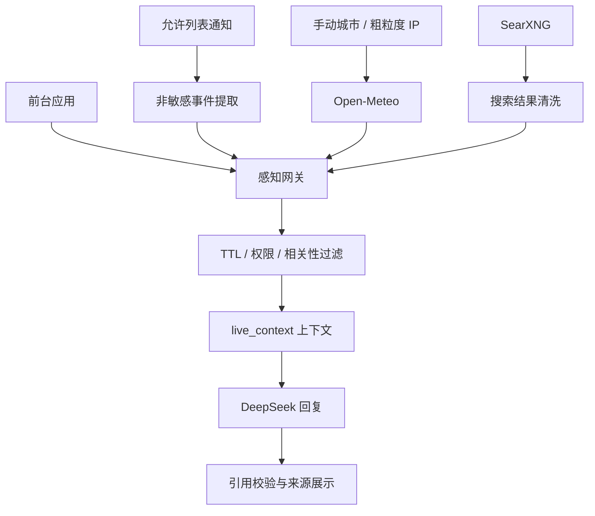

# 言语 1.7.0 感知系统设计与验收

日期：2026-11-25  
状态：Implemented  
关联决策：[ADR-0003](adr/0003-permissioned-perception.md)

## 1. 目标

让林在用户明确允许的前提下获得有限外部上下文，而不是只依赖用户当前一句话：

- 用户允许的通知应用产生包裹、课程或日历事件。
- 用户询问时读取最近一次前台应用。
- 用户询问天气时使用手动城市或公网 IP 的粗略城市。
- 用户询问题时效问题或明确“查一下”时，使用 SearXNG 获取带来源结果。
- 观察信息只服务当轮回答，不自动进入长期记忆。

## 2. 总体架构

## 3. 数据与生命周期

### 通知事件

`perception_events` 只保存：

- 来源包名和应用名。
- 事件类型：包裹、课程、日历。
- 已脱敏摘要。
- 观察时间、失效时间、置信度和敏感度。

保留时间：

| 类型 | TTL |
| --- | --- |
| 包裹 | 72 小时 |
| 课程 | 48 小时 |
| 日历 | 48 小时 |
| 普通通知 | 不持久化 |

`notification_sources` 只保存应用包名、显示名和最近出现时间，用于让用户选择来源。

### 搜索与天气

- 搜索结果最多 5 条，硬上限 8 条。
- SearXNG 请求超时 12 秒。
- 搜索 URL 只接受 HTTP/HTTPS；生产配置要求 HTTPS。
- 天气不保存经纬度，只把城市级结果送入上下文。
- IP 城市缓存 6 小时，并绑定 Android network handle。

## 4. 权限边界

| 能力 | 权限 | 默认 |
| --- | --- | --- |
| 通知事件 | NotificationListenerService 通知使用权 | 关闭，来源默认拒绝 |
| 前台应用 | Usage Access 特殊访问 | 关闭 |
| 天气城市 | 无定位权限；公网 IP 粗估 | 关闭 |
| 搜索 | 用户配置的 HTTPS 服务 | 关闭 |
| 屏幕内容 | 不在 1.7.0 范围 | 不申请 |

不申请 `QUERY_ALL_PACKAGES`，不使用无障碍服务。

## 5. 筛选顺序

1. 系统权限判断。
2. 来源允许列表判断。
3. 通知类型白名单。
4. OTP、密码、Token、手机号、证件、银行卡、地址和控制系统字符移除。
5. 当前问题相关性判断。
6. 新鲜度和 TTL 判断。
7. 最多 3 条通知、5 条搜索结果。
8. 外部文本以 `untrusted-data` 包裹并 XML 转义。
9. 搜索回答只展示模型实际使用的 `[S#]` 来源。

## 6. 搜索隐私

自动搜索不去发送整段用户消息：

- 明确命令“查一下/搜一下”只取命令后的短查询。
- 姓名、关系、工作、学校、情绪叙事等私人表达不自动搜索。
- 包含验证码、账号、证件、银行卡、手机号时直接跳过。
- 查询最长 120 字符。
- 搜索关闭或未配置时明确提示无法核实实时信息。

## 7. 失败处理

- 通知数据库异常不导致监听进程崩溃。
- 感知整体最多等待 30 秒，超时后继续普通聊天。
- 搜索失败或零结果不虚构来源。
- 天气失败时如果没有搜索则明确告知；如果配置搜索可降级搜索。
- 读取失败只能提供“无法核实实时信息”的 note，不得假装看见。

## 8. 明确不承诺

- 原应用关闭通知后仍能读取其包裹状态。
- 读取其他应用内部后台进程或私有数据。
- 通过 IP 精确判断位置。
- 仅凭“大学生”身份推断课表。
- 未经系统授权持续录屏或读取通知。
- 首版理解图片、图表和屏幕布局。

## 9. 验收用例

1. 默认不保存任何通知正文。
2. 未允许来源只出现包名和应用名。
3. 允许菜鸟后，包裹通知转成脱敏摘要。
4. 取件码和详细地址不进入事件摘要。
5. “123456是验证码”被脱敏。
6. 银行卡、手机号、Token 被脱敏。
7. 普通聊天通知不持久化。
8. 包裹事件 72 小时后不返回。
9. 课程事件 48 小时后不返回。
10. 撤销通知使用权后，历史事件不进入上下文。
11. 关闭来源后，该来源历史事件不进入上下文。
12. “我下课去吃饭，快递到了吗”可关联包裹事件。
13. 普通情绪聊天不注入通知。
14. 通知摘要进入模型前 XML 转义。
15. 搜索默认关闭。
16. 未配置 SearXNG 时明确说无法联网核实。
17. SearXNG 只接受无凭据 HTTPS URL。
18. `javascript:`、`data:` 结果被拒绝。
19. 搜索最多返回 5 条。
20. 空结果不会显示“已联网搜索 0 个来源”。
21. 私人叙事不会原样发给搜索服务。
22. 明确“查一下”只发送命令后的短查询。
23. 验证码、证件号等消息不触发自动搜索。
24. 模型实际引用 `[S1]` 时才追加对应 URL。
25. 模型未引用时不追加无关 URL。
26. 手动城市优先于公网 IP 城市。
27. 网络切换后不会沿用另一个网络的缓存城市。
28. 前台应用仅保留 2 分钟内的 resumed 状态。
29. 感知读取失败不阻塞聊天。
30. Room v4→v5→v6 迁移保留聊天和长期记忆。
31. SQLCipher 数据库可创建感知事件表。
32. 感知页面可打开通知使用权和使用情况访问。
33. 感知页面可清空事件和来源记录。
34. 1.6.2→1.7.0 覆盖安装后数据保留。

## 10. 后续版本

屏幕读取应作为独立版本处理，最低要求：

- MediaProjection 单次明确授权。
- 前台服务和系统采集提示。
- 本地 OCR 优先。
- 发送前预览和敏感应用暂停。
- 截图不写相册、不自动写记忆。
- 用户拒绝时不降级到无障碍或后台偷拍。
