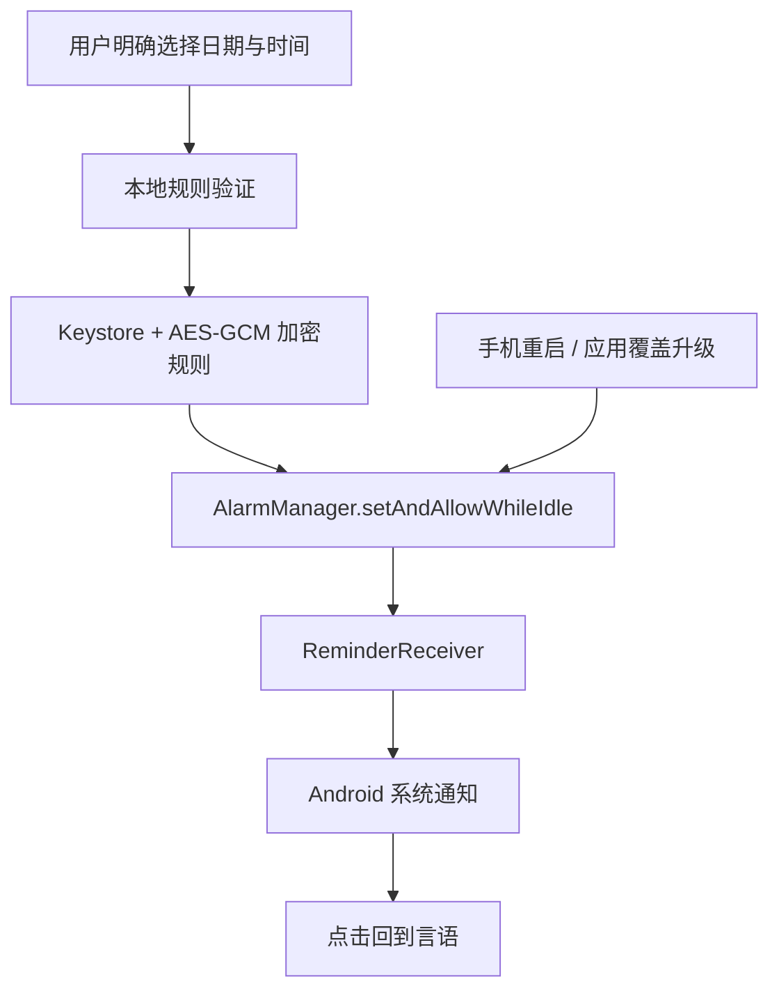

# 言语 1.8.0：主动提醒与最终验收

日期：2026-11-25  
产品：言语  
伴侣：林  
状态：Implemented

## 1. 版本目标

1.8.0 不再扩大“林能看到什么”，而是补齐两个可信度缺口：

1. 用户明确设定的事项可以在离开聊天后主动提醒。
2. 联网搜索不再把未经用户确认的可能私密查询直接发给外部服务。

产品边界保持不变：

- 不做成人露骨内容。
- 当前是个人 BYOK 版，不包含统一充值、代理转售、公共账号或额度后台。
- 不读取屏幕、不读取其他应用内部数据、不使用无障碍服务。
- AI 不负责猜时间或执行调度；时间由用户明确设定，调度由本地确定性规则完成。

## 2. 品牌与兼容

| 项目 | 1.8.0 决策 |
| --- | --- |
| 应用显示名 | 言语 |
| 默认伴侣名 | 林 |
| Android applicationId | `com.xinyu.companion`，保持不变 |
| 数据库文件名 | `xinyu-encrypted.db`，保持不变 |
| 伴侣内部 ID | `companion-linyu`，保持不变 |
| 主题与监听服务类名 | 保留 `XinYu` 内部标识 |

显示名与内部身份分离是有意的：改名不能造成旧聊天、旧记忆、Keystore 密钥和 API Key
失联。历史聊天正文也不会被批量改写。

## 3. 本地提醒架构



### 数据与权限

- 单条规则包含：稳定 ID、提醒文字、触发时间、创建时间。
- 最多保存 30 条，提醒文字最多 120 字。
- 只接受未来时间；过去时间、空文字和超额规则会被拒绝。
- 提醒规则使用独立 Keystore 密钥加密，不进入 Room、长期记忆或模型提示词。
- 不申请 `SCHEDULE_EXACT_ALARM`。
- 使用 `setAndAllowWhileIdle`，省电模式下可能延迟。
- Android 13+ 使用 `POST_NOTIFICATIONS`；未授权时不允许创建新提醒。
- 重启恢复使用 `RECEIVE_BOOT_COMPLETED`。

### 失败与取消

- 保存规则后若系统闹钟注册失败，会回滚已保存规则。
- 用户删除规则时同时撤销 PendingIntent/系统闹钟。
- 到点且通知权限有效时，先确认规则仍存在，再发通知并从待处理列表移除。
- 通知若因权限被中途关闭而无法送达，规则不会静默消失，界面会显示时间已过。

## 4. 搜索确认架构

```text
用户消息
→ 本地识别搜索意图
→ 暂停发送
→ 展示准备外发的查询词
→ 用户编辑 / 确认搜索 / 仅聊天
→ 只把确认后的查询交给 SearXNG
```

- 授权只绑定当前消息，不写入设置、不持久化。
- 重试不会自动复用上一次搜索授权。
- 验证码、证件号、银行卡、密码、手机号和家庭住址等硬敏感字段即使确认也拒绝外发。
- 天气可直接使用 Open-Meteo；天气失败时不会绕过确认偷偷调用 SearXNG。
- 搜索结果继续保持不可信数据隔离、数量/长度限制和实际引用才展示来源。

## 5. 明确不提供

- 不在后台自动判断“现在该取快递”。
- 不根据大学生身份、通知标题或使用习惯推算课程表。
- 不保证 Android 省电模式下分钟级准时。
- 不在应用被系统强行停止后自行复活。
- 不提供日历同步、周期规则、贪睡、位置围栏或系统闹钟界面集成。

这些能力若后续加入，必须继续遵守“明确来源、可取消、可解释、默认关闭”的原则。

## 6. 验收结果

- JVM/Robolectric：159/159。
- Android 15 instrumentation：14/14。
- `lintDebug`：0 error，仅保留依赖版本提示。
- `assembleDebug`：通过。
- 1.7.0 → 1.8.0 覆盖安装：通过。
- Android 15 实际验证：加密规则 → AlarmManager → BroadcastReceiver → 通知。
- 搜索前确认、编辑、仅聊天、重复提交阻断均有测试。

## 7. 后续建议

优先级最高的下一个产品能力不是更多“眼睛”，而是：

1. 日历导入或用户课程表，让已知事件可形成候选提醒。
2. 用户确认后的包裹事件提醒，最多一次，可标记“已取件”。
3. 提醒贪睡和每日/每周规则。
4. 公开分发前冻结 release 签名、包名和服务端代理合规方案。
