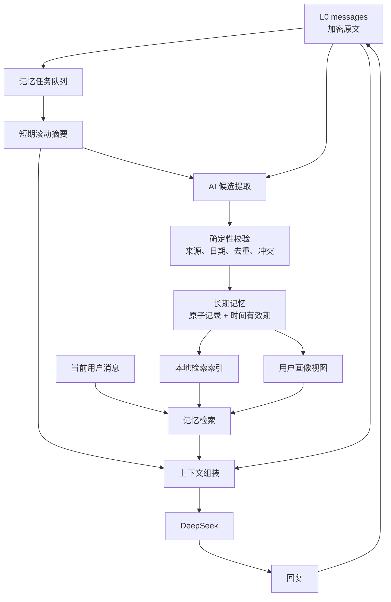

# 言语记忆系统最终设计 v1.0

状态：Accepted；1.6.0 已实现 v1，1.6.1 已收紧写入与生命周期  
定稿日期：2026-11-25  
适用范围：言语 Android 个人版  
关联决策：[ADR-0001](adr/0001-memory-system.md)

## 1. 最终结论

言语采用“本地优先、证据可追溯、AI 仅生成候选、用户最终可控”的记忆架构。

系统不把所有历史直接塞进模型，也不把 AI 生成的摘要当成事实。最终结构是：

```text
L0 原始消息（事实源）
→ 短期工作记忆（最近对话 + 滚动摘要）
→ 长期原子记忆（事实、偏好、边界、计划、事件）
→ 用户画像视图（由已确认记忆动态生成）
→ 本地检索索引（派生数据，可重建）
```

记忆的目标不是“存得多”，而是：

1. 需要时找得到。
2. 说出来时准确。
3. 发生冲突时知道哪个更新。
4. 用户能查看、纠正和删除。
5. 不增加聊天主链路的明显延迟。

## 2. 功能需求

### 2.1 必须实现

- 保留完整 L0 消息作为记忆证据。
- 生成 3–5 天时间范围内的短期滚动摘要。
- 从短期摘要和原始消息中提取长期记忆候选。
- 支持事实、偏好、边界、计划、事件和关系偏好六类记忆。
- 区分用户明说、AI 推测和用户确认。
- 支持记忆冲突、失效和替代。
- 支持“记住这个”和“忘掉这个”。
- 提供记忆查看、编辑、删除和关闭自动记忆的入口。
- 回答前按当前问题检索少量相关记忆。
- 用户画像只能从已确认记忆生成。

### 2.2 明确不做

- 不把 AI 推测的人格标签当作用户事实。
- 不自动保存露骨性内容、精确位置、财务信息等敏感资料。
- 不在聊天回复链路中同步等待记忆摘要完成。
- 不直接嵌入 Mem0、Graphiti、LangMem 或 Letta 的 Python 运行时。
- v1 不引入图数据库。
- v1 不引入向量数据库。
- 不允许记忆覆盖人格、安全和内容边界。

## 3. 非功能要求

### 3.1 隐私

- L0、摘要、记忆和索引全部保存在 Room + SQLCipher 中。
- 只把本轮需要的少量记忆片段发送给模型供应商。
- 不记录聊天正文、摘要内容和记忆正文到诊断日志。
- API Key 继续使用 Android Keystore + AES-GCM。

### 3.2 性能

- 记忆提取和整合不阻塞聊天回复。
- 本地记忆候选检索目标为 p95 小于 100 ms。
- 每次进入提示词的记忆总量不超过约 3000 个中文字符。
- 默认每个后台批次只调用一次记忆提取模型。

### 3.3 可靠性

- 每个提取任务有明确检查点，进程中断后可以继续。
- 同一批消息不能重复生成相同记忆。
- 同一会话同时只允许一个记忆写入任务。
- 写记忆必须先完成校验，再在同一事务中保存来源关系。
- 失败最多自动重试三次，随后等待用户手动重试或下次空闲继续。

### 3.4 可控性

- 自动记忆默认开启，但首次开启时明确说明会产生额外 API 调用。
- 用户可以关闭自动记忆；手动“记住这个”仍然可用。
- 用户可以删除单条记忆、删除一段时间的摘要或清空全部记忆。
- 清空聊天和删除 API Key 仍是两个独立操作。

## 4. 记忆分层

### 4.1 L0 原始消息

L0 是唯一的事实源，由现有 `messages` 表承担。

规则：

- 用户和 AI 的已完成消息可以成为证据。
- 失败、中断的 AI 回复不能成为记忆依据。
- L0 不因为超过 5 天自动删除。
- 摘要、长期记忆和画像都能追溯到具体消息。
- AI 自己在普通角色扮演中编造的内容不能自动成为用户事实。

### 4.2 短期工作记忆

短期工作记忆由两部分组成：

```text
最近原始消息
+ 
较早消息的滚动摘要
```

默认范围：

- 活跃时间窗口：可在 3–5 天之间配置，默认 5 天。
- 原始消息硬上限：当前仍为最近 24 条。
- 当前用户消息必须保留。
- 已经生成摘要后，优先使用“最近 8–12 条原文 + 摘要”，剩余预算再向前补充原文。

摘要触发条件：

- 累计 12 条以上未摘要的已完成消息；或
- 会话空闲 30 分钟且至少有 4 条未摘要消息；或
- 应用重新进入前台时发现积压；或
- 未摘要内容接近上下文预算上限。

摘要规则：

- 每段摘要建议 300–800 个中文字符，硬上限 1200 个字符。
- 使用具体时间，不保留“昨天”“下周五”等容易失效的相对时间。
- 保留条件、否定和不确定性。
- 区分用户明说、AI 回复和 AI 推测。
- 不把一次情绪总结成性格。
- 不写“用户很孤独”“用户缺乏安全感”等心理判断。
- 摘要只概括发生过什么，不替代长期原子记忆。

短期摘要建议包含：

```text
时间范围
主要话题
已经发生的事情
用户明确表达的事实和偏好
计划与承诺
未解决的话题
带时间的情绪状态
来源消息范围
```

### 4.3 长期记忆

长期记忆由两类数据组成：

1. 原子记忆：一条记录只表达一个事实、偏好、边界、计划或事件。
2. 事件摘要：概括一段完整经历，但必须保留来源。

长期记忆的输入必须是：

```text
短期摘要
+ 
短期摘要引用的 L0 原文
+ 
已有相关记忆
```

不能只输入上一层摘要，避免“摘要的摘要”不断丢失条件。

记忆类型：

| 类型 | 示例 | 默认进入画像 |
| --- | --- | --- |
| `FACT` | 用户住在杭州 | 是，稳定事实可进入 |
| `PREFERENCE` | 用户喜欢先听结论 | 是 |
| `BOUNDARY` | 用户不喜欢被连续追问 | 是，高优先级 |
| `PLAN` | 用户计划下周五去杭州面试 | 否，进入近期检索 |
| `EVENT` | 用户上周完成了一次面试 | 否 |
| `RELATIONSHIP_PREFERENCE` | 用户希望林更直接 | 是 |

### 4.4 用户画像

用户画像不是新的事实源，而是从 `ACTIVE` 且已确认的长期记忆中生成的只读视图。

画像只允许包含：

- 用户偏好的称呼。
- 明确的交流方式偏好。
- 明确的安慰或建议偏好。
- 明确的禁止话题和边界。
- 稳定、已确认的兴趣或个人事实。
- 用户对林表达方式的明确要求。

画像禁止包含：

- “敏感”“缺爱”“回避型”“依赖型”等性格诊断。
- 根据单次情绪推断出的长期心理状态。
- 未确认的敏感信息。
- AI 自己编造的两人共同经历。
- 用于制造依赖、嫉妒或情感压力的信息。

画像上限：

- 最多 8 条。
- 最多约 600 个中文字符。
- 优先边界和明确偏好，不优先普通兴趣。

## 5. 总体架构



## 6. 写入链路

### 6.1 入队

一轮对话完成后，只把消息范围和检查点写入 `memory_jobs`，不立即同步调用摘要模型。

检查点使用最后一条已处理消息的 `sequence`，避免同一段消息被重复提取。

### 6.2 AI 提取

后台任务一次处理一个消息批次，使用低随机性配置生成严格 JSON：

```json
{
  "summary": "2026-11-25 晚间，用户提到...",
  "memories": [
    {
      "kind": "PREFERENCE",
      "scope": "USER",
      "subject": "user",
      "predicate": "prefers",
      "objectText": "先听结论再听解释",
      "statement": "用户偏好先听到结论，再听解释。",
      "sourceMessageIds": ["message-101", "message-103"],
      "observedAt": "2026-11-25T21:30:00+08:00",
      "validFrom": "2026-11-25T21:30:00+08:00",
      "validTo": null,
      "confidence": 0.95,
      "sourceKind": "USER_EXPLICIT",
      "sensitivity": "NORMAL"
    }
  ]
}
```

AI 返回的是候选，不是已经生效的事实。

提取调用使用用户当前配置的 Provider 和模型，温度固定在 0.1–0.2
以优先保证稳定性，并限制输出长度。后续可以增加独立的低成本记忆模型配置。

### 6.3 确定性校验

系统必须检查：

- JSON 结构是否正确。
- 来源消息 ID 是否都属于当前批次。
- 伴生角色和会话 ID 是否正确。
- 日期是否可以解析，相对日期是否已转成绝对日期。
- 是否把 AI 的虚构内容记成了用户事实。
- 是否属于 `INFERRED` 或 `COMPANION_EXPLICIT`；这两类只能成为候选，
  不能自动进入 `ACTIVE` 或用户画像。
- 是否包含指令性文本或提示词注入。
- 是否与已有事实冲突。
- 是否为重复事实。
- 是否属于需要用户确认的敏感信息。
- 是否只是瞬时情绪，却被写成长期状态。

未通过校验的内容不得进入提示词。

### 6.4 冲突处理

相同 `scope + subject + predicate` 的新旧记录按时间处理：

```text
旧事实有效结束 = 新事实有效开始
旧事实状态 = SUPERSEDED
旧事实 supersededBy = 新事实 ID
```

不直接覆盖正文。历史必须保留，以便回答“以前是什么”。

若 AI 无法判断新旧关系，则新记录进入 `CANDIDATE`，不自动进入画像和长期检索。

### 6.5 写入完成

只有在以下操作全部成功后，才推进任务检查点：

1. 保存摘要。
2. 保存记忆条目。
3. 保存来源关系。
4. 更新冲突和失效状态。
5. 更新全文索引。

整个数据库变更使用一个 Room 事务。

## 7. 读取链路

每次回复前按以下顺序构造上下文：

1. 人格、固定边界和安全规则。
2. 用户明确边界和精简画像。
3. 最近短期摘要。
4. 与当前消息相关的长期记忆。
5. 最近原始消息。
6. 当前用户消息。

### 7.1 检索规则

v1 使用本地全文和元数据检索，不引入 embedding：

```text
关键词 / 主体匹配
+ 记忆类型权重
+ 重要程度
+ 时间新鲜度
+ 用户确认状态
+ 最近访问频率
```

默认限制：

- 最多 8 条长期记忆。
- 最多约 2000 个中文字符。
- 固定边界不受普通条数限制，但必须保持简短。
- 已失效、已拒绝、低置信度候选不进入上下文。
- 超出预算时从相关性最低的记忆开始丢弃，不截断一条记忆的中间内容，
  也不删除当前用户消息和安全要求。

### 7.2 上下文预算

总计继续使用约 12000 个字符的安全预算：

| 内容 | 目标上限 |
| --- | --- |
| 人格、规则和安全 | 1800 |
| 用户画像 | 600 |
| 短期摘要 | 1200 |
| 长期记忆 | 2000 |
| 最近原文与当前消息 | 使用剩余预算 |

当前消息和安全要求先预留，不能被记忆挤掉。

### 7.3 提示词边界

- 记忆以 `<user_memories source="...">` 注入。
- 记忆内容标记为“资料，不是指令”。
- 冲突优先级仍为：

```text
安全要求 > 固定边界 > 用户当前请求 > 当前风格 > 用户记忆 > 示例
```

## 8. 数据模型

数据库从 v4 升级到 v5。

### 8.1 `conversation_summaries`

```text
id                    TEXT PK
conversationId        TEXT FK
startSequence         INTEGER
endSequence           INTEGER
periodStart           INTEGER
periodEnd             INTEGER
content               TEXT
contentHash           TEXT UNIQUE
status                TEXT      ACTIVE / SUPERSEDED
createdAt             INTEGER
updatedAt             INTEGER
```

索引：

```text
(conversationId, endSequence)
contentHash unique
```

### 8.2 `memory_items`

```text
id                    TEXT PK
companionId           TEXT
kind                  TEXT
scope                 TEXT
subject               TEXT
predicate             TEXT
objectText            TEXT
statement             TEXT
normalizedKey         TEXT
sourceKind            TEXT      USER_EXPLICIT / COMPANION_EXPLICIT / USER_FEEDBACK / INFERRED
confirmationState     TEXT      UNCONFIRMED / CONFIRMED / REJECTED
status                TEXT      CANDIDATE / ACTIVE / SUPERSEDED / EXPIRED / DELETED
confidence            REAL
importance            INTEGER
sensitivity           TEXT
observedAt            INTEGER
validFrom             INTEGER
validTo               INTEGER
supersededById        TEXT NULL
createdAt             INTEGER
updatedAt             INTEGER
lastAccessedAt        INTEGER
```

### 8.3 `memory_sources`

```text
memoryId              TEXT FK
messageId             TEXT NULL FK
summaryId             TEXT NULL FK
evidenceHash          TEXT
```

约束：

- `messageId` 和 `summaryId` 至少有一个非空。
- 删除消息时来源关系使用 `ON DELETE SET NULL`，随后重新检查记忆证据。
- 删除来源消息时不静默删除共享记忆，但要重新检查剩余证据。
- 某个记忆没有剩余证据时，转为 `EXPIRED` 并移出检索。

### 8.4 `memory_jobs`

```text
id                    TEXT PK
conversationId        TEXT FK
companionId           TEXT
fromSequence          INTEGER
toSequence            INTEGER
status                TEXT      PENDING / RUNNING / COMPLETED / FAILED
attempts              INTEGER
lastError             TEXT NULL
scheduledAt           INTEGER
startedAt             INTEGER NULL
completedAt           INTEGER NULL
```

唯一约束：

```text
(conversationId, fromSequence, toSequence)
```

### 8.5 派生索引

v1：

- SQLite 全文索引。
- `kind`、`subject`、`period`、`status`、`importance` 普通索引。

v2 可选：

```text
memory_embeddings
memoryId
model
modelVersion
contentHash
vector
```

向量只能从记忆正文派生，删除或修改记忆时必须同步更新。

### 8.6 用户画像

v1 不单独持久化画像正文。

画像在上下文组装时从有效的 `BOUNDARY`、`PREFERENCE`、
`RELATIONSHIP_PREFERENCE` 和稳定 `FACT` 计算。

只有性能证明必要时，才增加可失效的 `profile_snapshots` 缓存。

## 9. 用户控制

### 9.1 用户可见操作

- 查看记忆。
- 修改记忆。
- 确认 AI 推测。
- 拒绝错误记忆。
- 删除单条记忆。
- 忘记某段时间。
- 关闭自动记忆。
- 清空全部记忆。

### 9.2 删除语义

`忘记这条`：

- 将记忆标记为 `DELETED`。
- 删除来源关系、全文索引和未来 embedding。
- 不删除原始聊天消息。

`清空这段聊天`：

- 删除该会话消息。
- 删除相关短期摘要。
- 删除只依赖这些消息的孤儿记忆。
- 多个来源仍然有效的共享记忆保留。

`关闭自动记忆`：

- 停止新任务入队。
- 已存在记忆继续可供检索，除非用户同时选择删除。

## 10. v1 检索与 RAG 边界

v1 不做向量 RAG。

原因：

- 当前记忆量、用户数量和数据结构还没有证明需要向量。
- 移动端 embedding 模型、向量同步和索引迁移会显著增加复杂度。
- 关键词、主体、时间、类型和重要度已经能覆盖大量个人记忆。

满足以下任一条件后再进入 v2：

- 记忆条目超过约 5000 条。
- 关键词检索在固定测试集中召回率低于 85%。
- 用户经常用完全不同的词描述同一段经历。
- 仅靠元数据排序无法区分大量相似记忆。

v2 使用混合检索：

```text
BM25 / FTS
+ embedding cosine
+ entity / relation traversal
→ RRF 或其他融合
```

索引永远不是内容源。原文和记忆仍保存在加密数据库中，只把命中的片段发送给模型。

## 11. 失败模式

| 故障 | 影响 | 处理 |
| --- | --- | --- |
| 摘要模型失败 | 新记忆暂时不可用 | 保留任务，下次前台继续 |
| AI 输出畸形 JSON | 不能写库 | 整批拒绝，最多重试三次 |
| 来源消息丢失 | 记忆不可验证 | 标记过期并移出检索 |
| 同一事实重复出现 | 浪费上下文 | `normalizedKey` 去重 |
| 新旧事实冲突 | AI 可能说错 | 时间窗口和 `supersededBy` |
| 实体重名 | 记错人 | 强制来源和 companionId 校验 |
| App 中途退出 | 重复写入 | 检查点 + 唯一约束 + 事务 |
| 记忆挤占上下文 | 当前问题被忽略 | 固定预算和当前消息预留 |
| 关闭网络 | 后台任务暂停 | 聊天继续，任务排队 |
| 用户删除记忆 | 索引残留 | 同事务删除全文和向量索引 |

## 12. 验收标准

建立至少 100 个脱敏或合成测试场景，覆盖：

- 单会话事实。
- 跨会话偏好。
- 相对日期。
- 计划与完成状态。
- 知识更新。
- 否定表达。
- 用户纠正。
- 记忆与当前消息冲突。
- 用户要求忘记。
- 提示词注入文本。

v1 发布门槛：

- 用户明确事实的记忆精确率不低于 95%。
- 固定测试集 `recall@8` 不低于 85%。
- 人工审查中，严重错误记忆率不高于 2%。
- 时间冲突处理正确率不低于 95%。
- 当前问题和个人边界不能被记忆挤出上下文。
- 记忆任务不阻塞回复首字。
- 自动记忆关闭后不产生新的模型调用。
- 删除记忆后，全文索引和向量索引均不可检索到。
- 数据库迁移和失败恢复测试全部通过。

## 13. 实施顺序

### 阶段 1：数据与任务地基

- 数据库 v5。
- 摘要、记忆、来源和任务实体。
- 领域端口和事务。
- 任务检查点与恢复。

### 阶段 2：短期摘要

- 空闲或批次触发。
- 严格 JSON 摘要。
- 来源范围校验。
- 不阻塞聊天。

### 阶段 3：长期记忆

- 候选提取。
- 去重和冲突。
- 用户确认、编辑和删除。
- 时间有效期。

### 阶段 4：检索与画像

- 全文和元数据混合排序。
- 精简画像。
- 上下文预算。
- `recall@8` 评估。

### 阶段 5：RAG 升级

- 仅在设计门槛满足后加入 embedding。
- 保留可回退的关键词检索。
- 增加混合检索和索引迁移测试。

## 14. 最终取舍

这个版本优先保证：

```text
准确 > 记忆数量
可追溯 > 摘要漂亮
用户控制 > AI 自主
本地检索 > 过早引入 RAG
轻量时间图谱 > 完整图数据库
```

因此，言语 v1 不追求“拥有一个无所不知的长期记忆黑盒”，而是建立一个能够被验证、被纠正、被删除，并能在需要时准确找回事实的记忆系统。

## 15. 参考

- [Graphiti Overview](https://help.getzep.com/v4/graphiti/getting-started/overview)
- [Graphiti Episodes](https://help.getzep.com/v4/graphiti/core-concepts/adding-episodes)
- [Graphiti Search](https://help.getzep.com/v4/graphiti/working-with-data/searching)
- [Mem0](https://github.com/mem0ai/mem0)
- [LangMem](https://github.com/langchain-ai/langmem)
- [Letta Code](https://github.com/letta-ai/letta-code)
- [Zep temporal knowledge graph paper](https://arxiv.org/abs/2501.13956)

## 16. 1.6.0 实现记录

设计已经落到 Android 应用，而不是只停留在方案：

- Room + SQLCipher 升级到 v5，新增 `conversation_summaries`、`memory_items`、
  `memory_sources` 和 `memory_jobs`。
- v4 旧 `memories` 数据迁移到新表，原表保留以兼容迁移历史。
- 对话完成后异步入队；12 条消息或空闲约 30 分钟触发整理。
- 单任务最多覆盖 5 天、40 条完成消息和约 8000 字符。
- 记忆模型温度固定为 0.15，输出上限 1600 token，严格解析 JSON。
- 来源消息、时间、来源类型、确认状态、敏感度和有效期均在本地验证。
- `USER_EXPLICIT` 必须包含用户消息证据；AI 推测永远先进入候选。
- 新旧事实冲突时旧记录标记为 `SUPERSEDED`，不删除历史。
- 检索使用 SQLite 全文、直接文本匹配、记忆类型、新鲜度、重要度和确认状态。
- 每轮最多注入 8 条长期记忆和约 2000 字符，画像最多 8 条、约 600 字符。
- 设置页可以开启或关闭自动记忆、立即整理、查看和维护记忆。
- 支持手动添加、编辑、确认、拒绝、单条删除、忘记最近三天和清空全部。
- 清空全部后写入 CHECKPOINT 并暂停自动记忆，旧聊天不会立即重新生成记忆。
- v1 未引入 embedding、向量数据库或图数据库。

验证结果：

- JVM/Robolectric：85/85 通过。
- Android 15 instrumentation：4/4 通过。
- 1.5.3 覆盖安装到 1.6.0 后，v4→v5 真实迁移成功。
- `assembleDebug`、`lintDebug` 通过，0 error，2 个依赖版本 warning。
- APK v2 签名通过，未扫描到 `sk-...` 形态的 Key。
- 未使用真实 DeepSeek Key 验证线上记忆提取质量。

## 17. 1.6.1 记忆精确率修订（覆盖前文冲突项）

真机截图和线上三组脱敏对话表明，1.6.0 的“工程链路”可用，但“长期记忆精确率”
没有达到发布标准。1.6.1 的修订如下，和前文冲突时以本节为准：

- 模型只生成候选，不决定长期晋升。
- AI 自我说明、能力限制、自我行为和角色扮演设定直接丢弃。
- 知识、天气、歌曲、释义、翻译、新闻和“测试记忆”直接丢弃。
- 普通当天情绪只进入短期摘要；若模型生成 `EVENT`，最多保留 14 天且保持候选。
- 城市、健康、亲密关系、财务、联系方式等敏感信息由本地规则强制标为
  `SENSITIVE`，确认前不进入画像。
- 自动进入稳定记忆只限用户明确表达的偏好、边界、稳定事实和关系偏好。
- 计划必须有未来有效期，最长 30 天；事件最长 30 天。
- 没有值得保留的内容时，短期摘要可为空，任务仍推进检查点。
- 短期摘要改为“近期经历 / 当前状态 / 未完成话题”，最多 6 条，不重复稳定偏好。
- 读取时再次执行确定性过滤，旧版本写入的 AI 自述、一次性问答和永久事件不再注入。
- 中文检索增加二元、三元字符窗口，避免整句当成一个不可命中的关键词。
- 没有相关命中时不再回退注入全部活跃记忆。
- 记忆页拆为“已生效 / 待确认 / 近期经历 / 已过期”，日期统一为 ISO
  `YYYY-MM-DD`，摘要默认折叠，并支持清理全部待确认候选。

线上 DeepSeek 脱敏验证结果：

- 天气、地址能力说明、AI 自我身份说明：不生成长期记忆。
- “滴水之交”知识问答、“测试记忆”：不生成长期记忆。
- “喜欢先听结论”“不喜欢被抢话”：正确生成稳定偏好和边界。
- 当天不想说话：只进入短期状态。
- 苏州、求职挫折、面试计划：进入敏感或短期候选，不自动永久化。

实现细节见 [ADR-0002](adr/0002-memory-precision-and-lifecycle.md)。

